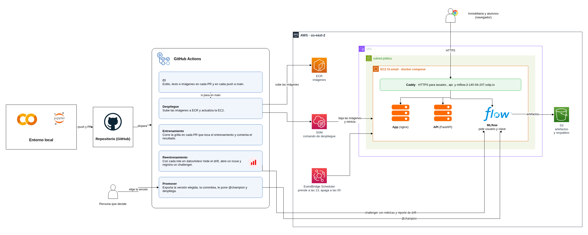
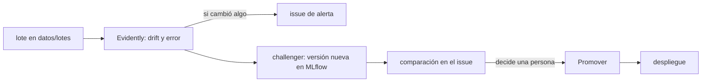

# Tasador de casas: regresión lineal en producción

Predice el precio de viviendas con regresión lineal múltiple (Boston
Housing, sin la variable B). Arrancó como TP en un notebook y está
publicado como la app de una inmobiliaria, con su modelo versionado,
desplegado y monitoreado.

Materia: Aprendizaje Automático 1, Tecnicatura Universitaria en
Inteligencia Artificial (FCEIA, UNR).
Integrantes: Tomás Avecilla y Franco Calcia.

- App: <https://tasador.3-140-54-207.sslip.io>
- API: <https://api.3-140-54-207.sslip.io/docs>
- MLflow: <https://mlflow.3-140-54-207.sslip.io> (pide usuario y contraseña)

Las tres responden de 13 a 00, hora de Argentina. El resto del día la
instancia está apagada.

## Arquitectura



El código vive en GitHub y cada cambio pasa por GitHub Actions. La app,
la API y MLflow corren en una sola EC2 con docker compose, detrás de
Caddy, que sirve todo por HTTPS. Las imágenes están en ECR y los
artefactos de MLflow y los respaldos diarios de su base, en S3. El
diagrama se edita en `docs/arquitectura.drawio`.

## Estructura

| Ruta | Qué es |
| --- | --- |
| `notebooks/` | El TP original (EDA, modelos y comparación) y sus requirements |
| `datos/` | El dataset (`house-prices-tp.csv`) y, en `lotes/`, los lotes de casas nuevas |
| `entrenamiento/entrenar.py` | Entrena el pipeline y lo registra en MLflow |
| `entrenamiento/buscar_hiperparametros.py` | Entrena la grilla de modelos e hiperparámetros |
| `entrenamiento/exportar_modelo.py` | Baja la versión `@champion` (o la de `--version`) a `docker/modelo.joblib` y anota en `docker/modelo.json` de qué versión salió |
| `entrenamiento/reentrenar.py` | Reentrena con los lotes, compara contra producción y registra el challenger |
| `entrenamiento/promover.py` | Le pone el alias `@champion` a una versión |
| `entrenamiento/inspeccionar_modelo.py` | Muestra qué aprendió el pipeline guardado en el binario |
| `monitoreo/` | Genera lotes de casas nuevas y detecta drift con Evidently |
| `docker/` | La entrega del TP: inferencia por lotes en un contenedor (ver su README) |
| `api/` | El mismo modelo servido con FastAPI |
| `app/` | La interfaz del tasador (HTML, CSS y JavaScript con nginx), que solo habla con la API |
| `docker-compose.yml` | Levanta la API y la app en local |
| `infra/` | Producción en AWS: plantilla de CloudFormation, compose con Caddy, MLflow y respaldos |
| `tests/` | Tests de la inferencia, la API, el modelo exportado y la promoción |
| `.github/workflows/` | CI, despliegue, entrenamiento en los PR, reentrenamiento y promoción |

## En local

```bash
python -m venv .venv && source .venv/bin/activate
pip install -r requirements.txt -r requirements-dev.txt -r api/requirements.txt
```

Sin `MLFLOW_TRACKING_URI`, los entrenamientos se guardan en `mlflow.db`,
en la raíz del repo:

```bash
python -m entrenamiento.entrenar --modelo elasticnet --alpha 0.1
mlflow ui --backend-store-uri sqlite:///mlflow.db
```

El mismo comando da el mismo RMSE en cualquier máquina: la partición y
la validación cruzada usan semillas fijas, y MLflow guarda la huella de los datos
de cada entrenamiento.

La grilla prueba los 4 modelos del TP con los 2 imputadores y 4 valores
de alpha: 26 versiones en un minuto y medio, más o menos. Se elige por
`rmse_cv` (validación cruzada sobre train). El `rmse_test` queda para el
modelo elegido.

```bash
python -m entrenamiento.buscar_hiperparametros
```

Después de ponerle el alias `champion` a la mejor versión en la UI, se
exporta y se prueba igual que en la entrega:

```bash
python -m entrenamiento.exportar_modelo
python docker/inferencia.py docker/casas_ejemplo.csv precios.csv
```

La app y la API juntas:

```bash
docker compose up --build
```

- App: <http://localhost:8501>
- API: <http://localhost:8000/docs>

Monitorear un lote y reentrenar. El challenger queda registrado como
versión nueva, pero `@champion` no cambia:

```bash
python -m monitoreo.generar_lote --tipo zona-nueva      # o suba-mercado
python -m monitoreo.detectar_drift datos/lotes/zona-nueva.csv
python -m entrenamiento.reentrenar
```

Antes de un PR, lo mismo que corre el CI:

```bash
pycodestyle .
pytest
```

## Workflows

| Workflow | Cuándo corre | Qué hace |
| --- | --- | --- |
| CI (`ci.yml`) | En cada PR y en cada push a `main` | Revisa el estilo, corre los tests y construye las imágenes |
| Despliegue (`desplegar.yml`) | Cuando el CI de `main` termina en verde, o a mano | Sube las imágenes a ECR, la EC2 las baja y reinicia, y prueba la API publicada |
| Entrenamiento (`entrenamiento.yml`) | En los PR que tocan el entrenamiento | Corre la grilla en una máquina limpia y comenta el resultado en el PR |
| Reentrenamiento (`reentrenar.yml`) | Con cada lote nuevo en `datos/lotes/` | Mide drift y error, abre un issue y registra el challenger en MLflow |
| Promover (`promover.yml`) | A mano, con un número de versión | Pone esa versión en producción |

Las imágenes llevan como etiqueta el commit del que salieron, así que
volver a una versión anterior es desplegar esa etiqueta.

## Reentrenar y promover



Cuando llega un lote, `reentrenar.yml` trabaja contra el MLflow
publicado:

1. Evidently compara el lote con los datos de entrenamiento. Si el lote
   trae precios, también mide el error del modelo en producción.
2. Si hay drift o el error subió, abre un issue de alerta.
3. Entrena un challenger con el dataset más los lotes y lo registra como
   versión nueva de `precio-casas`. Champion y challenger se evalúan
   sobre el mismo test, y el reporte de Evidently queda en el run.
4. Comenta en el issue la comparación, el link a la versión y una
   recomendación: promover si el challenger se equivoca al menos un 1 %
   menos.

Producción no cambia hasta que una persona corre Promover desde la
pestaña Actions con el número de versión. Promover exporta esa versión,
corre los tests, commitea el binario en `main`, le pone `@champion` y
dispara el despliegue. El alias se mueve recién después del commit: si
algo falla antes, MLflow sigue apuntando al modelo de siempre. Si la
versión ya está en producción, no commitea nada.

Un push hecho con el token del workflow no dispara el CI, por eso
Promover lanza `desplegar.yml` directamente.

El pie de la app dice qué versión del registro está respondiendo:
`docker/modelo.json` viaja en la imagen de la API, y `/modelo` lo
devuelve.

## La app del tasador

Es la app que usaría un tasador de la inmobiliaria: carga una casa, ve
el precio sugerido y qué variables lo suben o lo bajan. El modelo no
está en la app: cada tasación es un pedido a la API. Son tres archivos
estáticos (`index.html`, `estilos.css` y `tasador.js`) sin paso de
construcción. nginx los sirve y reenvía `/api/` a la API, así el
navegador habla siempre con el mismo origen y no hace falta CORS.

## Producción en AWS

Toda la infraestructura está en `infra/plantilla.yml` (CloudFormation):
la instancia, la IP fija, los registros de ECR, el bucket, los permisos,
el comando de despliegue y los horarios de encendido. GitHub Actions
usa un usuario de IAM que solo puede subir imágenes y correr ese
comando.

Un merge fuera del horario de encendido no se despliega. Se vuelve a
correr Despliegue desde Actions cuando la instancia está prendida.

## Antes de entregar la carpeta `docker/`

- [ ] `inferencia.py` solo llama a `predict`: nunca `fit` ni `fit_transform`.
- [ ] El binario tiene el pipeline completo: imputación, escalado y modelo.
- [ ] Las columnas de entrada salen del pipeline, no de una lista escrita a mano.
- [ ] `requirements.txt` tiene solo lo necesario para inferir, con la misma
      versión de scikit-learn que se usó para entrenar.
- [ ] `docker build` y `docker run` funcionan siguiendo el README.
