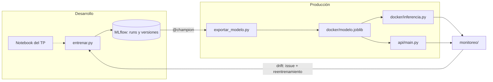

# House Price Regression — TUIA (Aprendizaje Automático 1)

Predicción del **precio de viviendas** (Boston Housing, sin la variable B)
con regresión lineal múltiple, llevada del notebook a producción con
prácticas de MLOps.

**Materia:** Aprendizaje Automático 1 — Tecnicatura Universitaria en Inteligencia Artificial (TUIA · UNR, Argentina)
**Integrantes:** Tomás Avecilla · Franco Calcia

## Dos entornos



En desarrollo se prueba todo lo que haga falta; a producción solo llega
la versión que tiene el alias `@champion`, exportada como un único
binario.

## Estructura

| Ruta | Qué es |
| --- | --- |
| `TP_regresion_AA1.ipynb` | El TP original: EDA, modelos y comparación |
| `entrenar.py` | Entrena el pipeline y lo registra en MLflow |
| `exportar_modelo.py` | Exporta la versión `@champion` a `docker/modelo.joblib` |
| `inspeccionar_modelo.py` | Muestra qué aprendió el pipeline y viaja en el binario |
| `docker/` | Inferencia por lotes en un contenedor (ver su README) |
| `api/` | El mismo modelo servido como API con FastAPI |
| `monitoreo/` | Genera lotes de casas nuevas y detecta drift con Evidently |
| `reentrenar.py` | Reentrena con los lotes y compara contra producción |
| `tests/` | Tests de la inferencia, la API y el modelo exportado |
| `.github/workflows/` | CI (`ci.yml`) y reentrenamiento por eventos (`reentrenar.yml`) |
| `datos/lotes/` | Donde llegan los lotes de casas nuevas |

## Cómo usarlo

```bash
python -m venv .venv && source .venv/bin/activate
pip install -r requirements.txt -r requirements-dev.txt -r api/requirements.txt
```

Entrenar y comparar modelos:

```bash
python entrenar.py --modelo lineal
python entrenar.py --modelo elasticnet --alpha 0.1
mlflow ui --backend-store-uri sqlite:///mlflow.db
```

Para elegir hiperparámetros, comparar por `rmse_cv` (validación cruzada
sobre train) y no por `rmse_test`, que queda para el modelo elegido:

```bash
for a in 0.01 0.05 0.1 0.2 0.5 1; do
    python entrenar.py --modelo elasticnet --alpha $a
done
```

En la UI, asignar el alias `champion` a la mejor versión y exportarla:

```bash
python exportar_modelo.py
python docker/inferencia.py docker/casas_ejemplo.csv precios.csv
```

Servir el modelo:

```bash
uvicorn api.main:app --reload        # documentación en localhost:8000/docs
```

Monitorear un lote nuevo y reentrenar:

```bash
python -m monitoreo.generar_lote --tipo zona-nueva      # o suba-mercado
python -m monitoreo.detectar_drift datos/lotes/zona-nueva.csv
python reentrenar.py
```

Tests y estilo (lo mismo que corre el CI):

```bash
pycodestyle .
pytest
```

## Antes de entregar la carpeta `docker/`

- [ ] `inferencia.py` solo llama a `predict`: nunca `fit` ni `fit_transform`.
- [ ] El binario tiene el pipeline completo: imputación, escalado y modelo.
- [ ] Las columnas de entrada salen del pipeline, no de una lista escrita a mano.
- [ ] `requirements.txt` tiene solo lo necesario para inferir, con la misma
      versión de scikit-learn que se usó para entrenar.
- [ ] `docker build` y `docker run` funcionan siguiendo el README.
