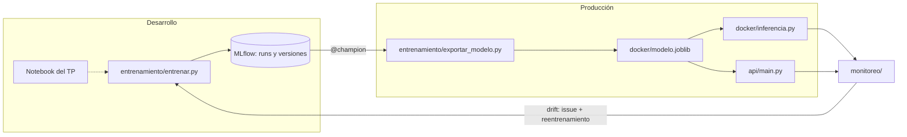
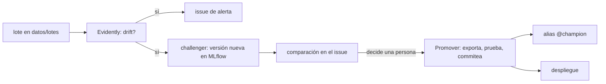
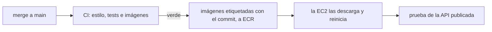

# House Price Regression — TUIA (Aprendizaje Automático 1)

Predicción del **precio de viviendas** (Boston Housing, sin la variable B)
con regresión lineal múltiple, llevada del notebook a producción con
prácticas de MLOps.

**Materia:** Aprendizaje Automático 1 — Tecnicatura Universitaria en Inteligencia Artificial (TUIA · UNR, Argentina)
**Integrantes:** Tomás Avecilla · Franco Calcia

## Dos entornos



En desarrollo se prueba todo lo que haga falta; a producción solo llega
la versión que tiene el alias `@champion`, exportada como un único
binario.

## Estructura

| Ruta | Qué es |
| --- | --- |
| `notebooks/` | `TP_regresion_AA1.ipynb`, el TP original (EDA, modelos y comparación), y sus requirements |
| `entrenamiento/entrenar.py` | Entrena el pipeline y lo registra en MLflow |
| `entrenamiento/buscar_hiperparametros.py` | Entrena la grilla de modelos e hiperparámetros |
| `entrenamiento/exportar_modelo.py` | Exporta la versión `@champion` (o la de `--version`) a `docker/modelo.joblib`, con `docker/modelo.json` al lado: de qué versión del registro salió |
| `entrenamiento/promover.py` | Asigna el alias `@champion` a una versión y resume la promoción |
| `entrenamiento/inspeccionar_modelo.py` | Muestra qué aprendió el pipeline y viaja en el binario |
| `docker/` | Inferencia por lotes en un contenedor (ver su README) |
| `api/` | El mismo modelo servido como API con FastAPI |
| `app/` | La interfaz del tasador (HTML, CSS y JavaScript servidos por nginx), que solo habla con la API |
| `docker-compose.yml` | Levanta la API y la app juntas |
| `infra/` | Producción en AWS: la plantilla de CloudFormation y el compose con HTTPS |
| `monitoreo/` | Genera lotes de casas nuevas y detecta drift con Evidently |
| `entrenamiento/reentrenar.py` | Reentrena con los lotes, compara contra producción y registra el challenger en MLflow |
| `tests/` | Tests de la inferencia, la API y el modelo exportado |
| `.github/workflows/` | CI (`ci.yml`), despliegue (`desplegar.yml`), entrenamiento en los PR (`entrenamiento.yml`), reentrenamiento por eventos (`reentrenar.yml`) y promoción de una versión (`promover.yml`) |
| `datos/` | El dataset (`house-prices-tp.csv`) y, en `lotes/`, donde llegan los lotes de casas nuevas |

## Cómo usarlo

```bash
python -m venv .venv && source .venv/bin/activate
pip install -r requirements.txt -r requirements-dev.txt -r api/requirements.txt
```

Entrenar y comparar modelos:

```bash
python -m entrenamiento.entrenar --modelo lineal
python -m entrenamiento.entrenar --modelo elasticnet --alpha 0.1
mlflow ui --backend-store-uri sqlite:///mlflow.db
```

Para elegir hiperparámetros, la grilla prueba los 4 modelos del TP con
los 2 imputadores y 4 valores de alpha (26 versiones, cerca de un minuto
y medio). Se compara por `rmse_cv` (validación cruzada sobre train), no
por `rmse_test`, que queda para el modelo elegido:

```bash
python -m entrenamiento.buscar_hiperparametros
```

En la UI, asignar el alias `champion` a la mejor versión y exportarla:

```bash
python -m entrenamiento.exportar_modelo
python docker/inferencia.py docker/casas_ejemplo.csv precios.csv
```

Servir el modelo:

```bash
uvicorn api.main:app --reload        # documentación en localhost:8000/docs
```

Monitorear un lote nuevo y reentrenar (el challenger queda registrado
como versión nueva, pero `@champion` no cambia):

```bash
python -m monitoreo.generar_lote --tipo zona-nueva      # o suba-mercado
python -m monitoreo.detectar_drift datos/lotes/zona-nueva.csv
python -m entrenamiento.reentrenar
```

Tests y estilo (lo mismo que corre el CI):

```bash
pycodestyle .
pytest
```

## Reentrenar y promover

Los lotes de casas nuevas se suben a `datos/lotes/`. Cada push a `main`
con un lote nuevo corre `reentrenar.yml` contra el MLflow publicado
(<https://mlflow.3-140-54-207.sslip.io>, con usuario y contraseña en los
secretos del repo):

1. Evidently revisa el lote: data drift y, si trae precios, degradación.
2. Si hay alguna de las dos, abre un issue de alerta.
3. Entrena un challenger con el dataset más los lotes y lo registra como
   versión nueva de `precio-casas`, con las métricas del challenger y
   del champion sobre el mismo test, y el reporte de Evidently como
   artefacto del run.
4. Comenta en el issue la comparación, el link a la versión y una
   recomendación (promover si mejora al menos 1%).

El workflow no toca producción: una persona mira la comparación y, si
conviene, corre **Promover** (pestaña Actions, con el número de versión).
Ese workflow exporta la versión, corre los tests, commitea el binario en
`main`, recién entonces asigna el alias `@champion` y dispara el
despliegue. En ese orden, MLflow y el repo no quedan desacoplados: si
algo falla antes del alias, el registro sigue apuntando a la versión de
siempre. Si la versión ya es la de producción, no commitea nada.
(Un push hecho con el token del workflow no dispara el CI, así que
Promover le pide el despliegue directamente a `desplegar.yml`.)



El pie de la app muestra qué versión del registro está respondiendo:
`modelo.json` viaja en la imagen de la API y `/modelo` lo expone.

## La aplicación del tasador

La app que usaría un tasador de la inmobiliaria: carga una casa, ve el
precio sugerido y qué variables lo empujan hacia arriba o hacia abajo.
No tiene el modelo adentro: cada tasación es un pedido a la API. Es una
página estática (`app/index.html`, `estilos.css`, `tasador.js`) sin
ningún paso de construcción; nginx la sirve y reenvía `/api/` a la API,
así el navegador habla siempre con el mismo origen y no hace falta CORS.

```bash
docker compose up --build
```

- App: <http://localhost:8501>
- API: <http://localhost:8000/docs>

## En producción

La API y la app están publicadas en una EC2 de AWS:

- App: <https://tasador.3-140-54-207.sslip.io>
- API: <https://api.3-140-54-207.sslip.io/docs>

Está prendida de 13 a 00 (hora de Argentina); el resto del día la
instancia se apaga sola para ahorrar crédito. Un merge fuera de ese
horario no se despliega: se vuelve a correr `Despliegue` desde Actions.

Cada merge a `main` que pasa el CI se despliega solo
(`.github/workflows/desplegar.yml`):



Toda la infraestructura está en `infra/plantilla.yml` (CloudFormation):
la instancia, la IP fija, los registros de imágenes, los permisos y el
comando de despliegue. Caddy (`infra/Caddyfile`) sirve todo por HTTPS.

## Antes de entregar la carpeta `docker/`

- [ ] `inferencia.py` solo llama a `predict`: nunca `fit` ni `fit_transform`.
- [ ] El binario tiene el pipeline completo: imputación, escalado y modelo.
- [ ] Las columnas de entrada salen del pipeline, no de una lista escrita a mano.
- [ ] `requirements.txt` tiene solo lo necesario para inferir, con la misma
      versión de scikit-learn que se usó para entrenar.
- [ ] `docker build` y `docker run` funcionan siguiendo el README.
